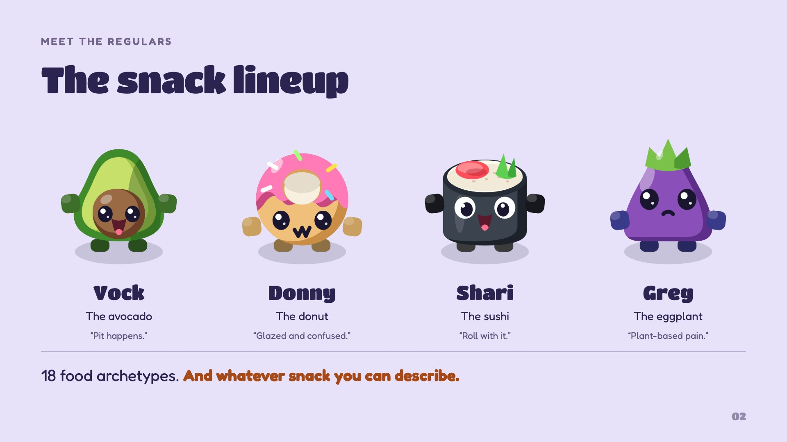

# Prompt Fu: a food fight you can prompt

**AI Grand Prix · One shared screen · Up to four fighters**

Describe a snack. Make it a fighter. Throw a boomerang at your friends. **Codex turns your words into fighters and arenas.** Phones become controllers, and the first snack to three round wins takes the podium.

[**Play Prompt Fu ↗**](https://prompt-fu-arena.gpyes44.chatgpt.site) · [**Slides ↗**](https://collaboration95.github.io/prompt-fu/slides.html) · [**Architecture ↗**](https://collaboration95.github.io/prompt-fu/architecture.html)


## How to play

1. **Make the arena.** Pick one of five presets or describe a place. The prompt sets the theme; the seed sets the layout.
2. **Make your fighter.** Describe a snack. Codex returns a recipe for its shape, colors, expression, weapon and catchphrase. The game draws it in code, with 18 food archetypes to build on.
3. **Join the brawl.** Scan the host's QR code, enter your name and take a fighter slot. Move with the right joystick. Throw and dash with the buttons on the left.
4. **Be the last snack standing.** Hide in bushes, grab power-ups and watch for returning boomerangs. First to three round wins gets the podium, complete with playful match awards.

Bots fill the configured empty slots. Leave the screen idle and they keep the arena moving under a “Scan to play” banner.


| Meet the fighters | Your phone, your fighter |
| --- | --- |
|  |  |

## Inside the arena


**The host runs the fight.** Its browser owns movement, collisions, bots and scoring. Phones send input about 20 times per second through a Node WebSocket relay.

**AI makes the recipes.** The backend runs Codex, validates its JSON and supplies deterministic fallback recipes when generation is unavailable. AI stays outside the gameplay loop.

**Sites is the front door.** The ChatGPT Site opens the backend-served game in an iframe. One Node process serves the game, connects the phones and handles generation.

## Run locally

Requires **Node.js 20+**. The game needs no dependency installation or build step.

```sh
gh repo clone Collaboration95/prompt-fu
cd prompt-fu
npm start
```

Open **http://127.0.0.1:8790**. An installed, authenticated Codex CLI enables prompt generation. Built-in fighters, bots and fallback recipes work without it.

To join with phones on the same network:

```sh
HOST=0.0.0.0 npm start
```

Open `http://<your-computer-LAN-IP>:8790` on the host screen before scanning its QR code, so the phones get an address they can reach. If the port is occupied, use `PORT=8791` with either startup command.

| Controller | Move | Throw | Dash |
| --- | --- | --- | --- |
| Keyboard player 1 | WASD | F | G |
| Keyboard player 2 | Arrow keys | K | L |
| Phone | Right joystick | Left THROW button | Left DASH button |

<details>
<summary><strong>Repository guide and presentation sources</strong></summary>

| Path | What's there |
| --- | --- |
| [`game/index.html`](game/index.html) | Host flow, game simulation and rendering |
| [`game/phone.html`](game/phone.html) | Phone join screen, controls and feedback |
| [`game/js/`](game/js/) | Arenas, fighter drawing, networking and podium |
| [`game/server/`](game/server/) | Static files, WebSocket relay and generation routes |
| [`game/CONTRACT.md`](game/CONTRACT.md) | Fighter and arena JSON shapes |
| [`docs/slides.html`](docs/slides.html) | Eight-slide HTML deck |
| [`docs/architecture.html`](docs/architecture.html) | Editable architecture diagram |
| [`docs/art/`](docs/art/), [`docs/images/`](docs/images/) | Game artwork and screenshots |
| [`sites-shell/`](sites-shell/) | Reference source for the hosted iframe shell |
| [`test/`](test/) | Server and browser checks |

**Slide controls:** arrow keys, swipe or navigation buttons. Press **F** for fullscreen. [Browse the slide images](docs/slides/).

</details>

---

Inspired by *Boomerang Fu*. Prompt Fu is an independent project built for AI Grand Prix. Its food fighters and arenas are drawn in code.
