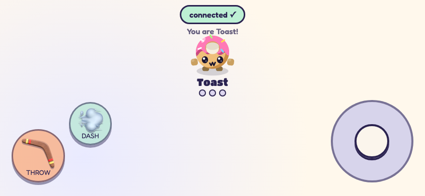

# Prompt Fu 🪃

Describe a snack. Make it a fighter. Throw a boomerang at your friends.

Prompt Fu is a couch party game built for the AI Grand Prix. One screen runs the arena; phones become controllers by scanning a QR code. Fighters and arenas can come from prompts, with deterministic recipes when AI generation is unavailable.

[Hosted demo](https://prompt-fu-arena.gpyes44.chatgpt.site) · [Architecture](docs/ARCHITECTURE.md) · [Development](CONTRIBUTING.md) · [Next steps](docs/ROADMAP.md)

The hosted demo depends on a separately running backend. To play independently, run your own copy below.

## Run it

Requires **Node.js 20 or newer**. The server has no runtime npm dependencies and needs no build step.

```sh
gh repo clone Collaboration95/prompt-fu
cd prompt-fu
npm start
```

Open **http://127.0.0.1:8790**. Pick an arena, choose a fighter, and press **FIGHT!** You can play with the built-in fighters and bots immediately. An installed, authenticated Codex CLI enables prompt generation; without it, the server returns deterministic fallback specs.

For phones on the same network, bind the server to your network interface:

```sh
HOST=0.0.0.0 npm start
```

Open `http://<your-computer-LAN-IP>:8790` on the host screen, then scan its QR code. Use the LAN address on the host too: a QR code generated from `localhost` points phones at themselves. If the network blocks device-to-device connections, use a network that permits them.

Already using port 8790? Run `PORT=8791 npm start`.

## Play

- Choose a preset arena or describe one. The seed controls the layout.
- Choose a built-in fighter or prompt your own snack. There are 18 code-drawn food archetypes.
- Up to four fighter slots share the arena. Phones take available slots; bots fill the remaining configured slots.
- Throw, dash, hide in bushes, and collect multi-shot, fire, and shield power-ups. First to three round wins gets the podium.
- Leave the game idle for 20 seconds to see a bot demonstration.

| Controller | Move | Throw | Dash |
| --- | --- | --- | --- |
| Keyboard player 1 | WASD | F | G |
| Keyboard player 2 | Arrow keys | K | L |
| Phone | Right joystick | Left THROW button | Left DASH button |

Phones work in portrait and landscape; landscape gives the controls more room. The host arena is intended for a larger screen.



*Local Chromium capture with touch input emulation.*

## How it works

The host browser runs movement, collisions, bots, scoring, and drawing. A small Node server serves the game, relays WebSocket messages between the host and phones, and runs optional AI generation. AI stays out of the gameplay loop.

The published ChatGPT Site is an iframe shell pointing at that backend. Publishing this repository does not deploy or change the hosted Site.

| Path | Purpose |
| --- | --- |
| `game/index.html` | Host flow, game simulation and rendering |
| `game/phone.html` | Phone join screen, joystick, buttons and feedback |
| `game/js/` | Arena generation, fighter drawing, networking and podium |
| `game/server/` | Static server, WebSocket relay and generation routes |
| `game/CONTRACT.md` | Fighter and arena JSON shapes |
| `sites-shell/` | Reference source for the hosted iframe shell |
| `test/` | Dependency-free server and relay checks |
| `docs/` | Architecture, verification and next steps |

## Development

```sh
npm run check
npm test
```

Tests start their own server on an ephemeral port and deliberately use an unavailable AI executable. They do not need credentials or contact a live AI service. CI runs these checks on Node 20, 22 and 24, plus Chromium touch-controller checks on Node 24. Playwright is an optional development dependency; see [CONTRIBUTING.md](CONTRIBUTING.md) for browser checks.

## Current limits

This is a working hackathon prototype. Rooms live in memory, the host browser must stay open, and there is no host migration or persistent leaderboard. Rooms and generation endpoints have no authentication or per-user rate limits; public hosting needs further hardening. The two-generation concurrency cap is not a usage quota.

The QR library loads from jsDelivr and fonts load from Google Fonts. Local play without AI is supported; fully offline QR generation is not yet bundled. The generator retains event-specific model names and CLI options, so other installations may use fallbacks until that adapter is made configurable.

## Credits and licensing

Inspired by *Boomerang Fu*. Fighters and arenas are drawn in code. Prompt Fu is an independent project and is not affiliated with Boomerang Fu.

No open-source license has been selected for this initial publication. The package is marked private to prevent accidental npm publication.
