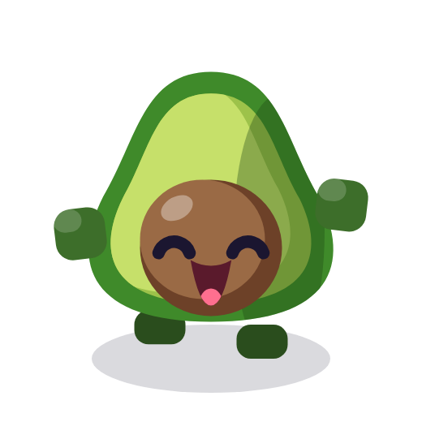
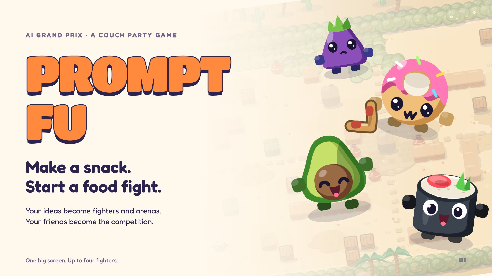
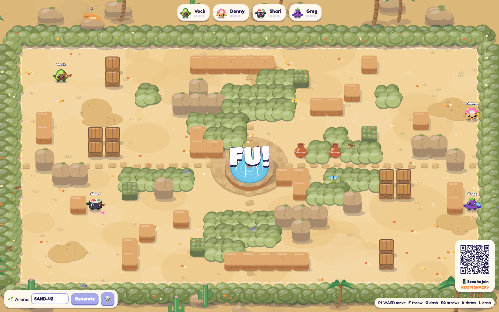
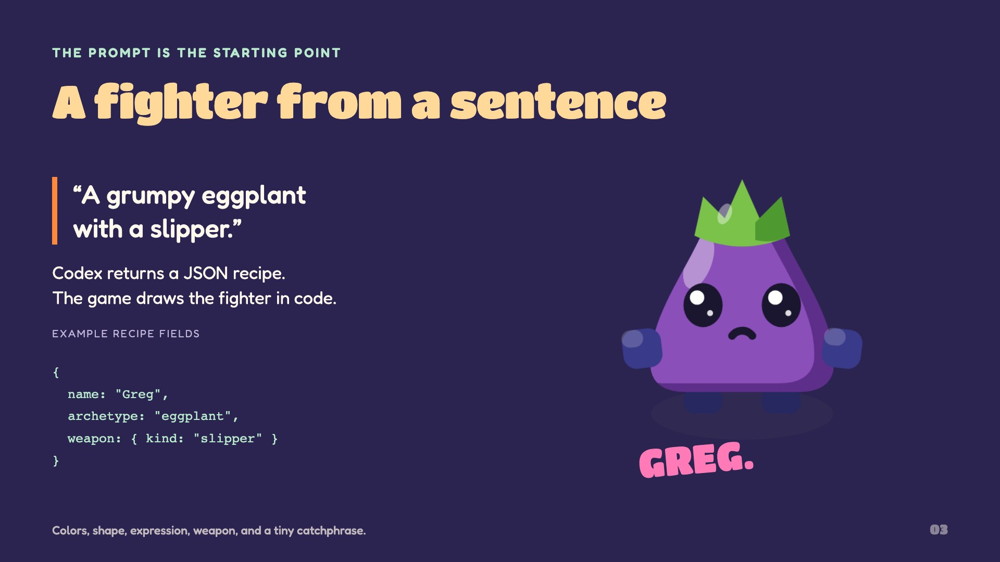
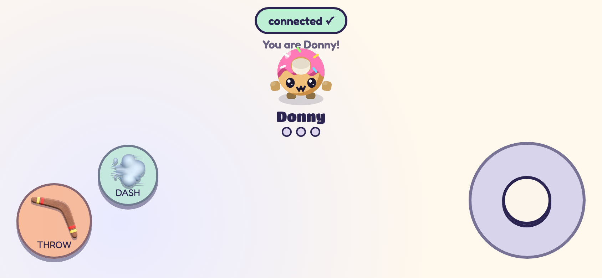
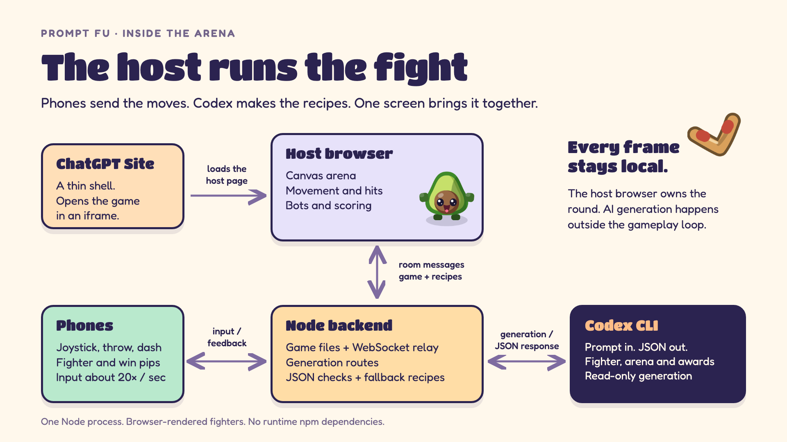

# Prompt Fu: a food fight you can prompt

**AI Grand Prix · A couch party game for one big screen and your phones**

Describe a snack. Make it a fighter. Throw a boomerang at your friends. **Codex turns your words into a fighter or an arena, and the game brings the recipe to life.** Everyone shares the same screen. Phones become controllers. First to three round wins gets the podium and a little roast.

[**Play Prompt Fu ↗**](https://prompt-fu-arena.gpyes44.chatgpt.site)



## Slides

[**Open the slides ↗**](https://collaboration95.github.io/prompt-fu/slides.html) · [Browse the slide images](docs/slides/) · [HTML source](docs/slides.html)

Eight slides, using the game's own food fighters, arenas and colors. Use the arrow keys, swipe, or tap the navigation buttons. Press **F** for fullscreen.

## How it works

1. **Make the arena.** Pick a preset or describe a place. The prompt sets the theme; the seed sets the layout. Desert, Autumn Dojo, Hawker Night, Bamboo Garden and Candy Land are ready to go.
2. **Make the fighter.** Describe your snack. Codex returns a JSON recipe for its shape, colors, expression, weapon and catchphrase. The game draws it in code, with 18 food archetypes to build on.
3. **Join the brawl.** Scan the host screen's QR code, enter your name and take a fighter slot. Your phone shows your own fighter and win pips. Move with the right joystick; throw and dash with the buttons on the left.
4. **Settle it.** Boomerangs come back. Bushes hide you. Multi-shot, fire and shield power-ups change the fight. Bots fill the configured empty slots, and the first fighter to three round wins takes the podium.
5. **Have another round.** Match awards give everyone a playful title. Leave the screen idle and the bots keep the arena moving under a “Scan to play” banner.



| A fighter from a sentence | Your phone, your fighter |
| --- | --- |
|  |  |

## Inside the arena



[**Explore the architecture ↗**](https://collaboration95.github.io/prompt-fu/architecture.html) · [Editable HTML source](docs/architecture.html)

- **The host runs the fight.** Its Canvas game owns movement, collisions, bots and scoring. Phones send joystick and button input about 20 times per second through a WebSocket relay.
- **One Node process connects everyone.** It serves the game, routes room messages and handles the fighter, arena and awards endpoints. The server has no runtime npm dependencies.
- **AI makes the recipes.** The backend runs Codex in a read-only generation process, then rebuilds its JSON from allowed fields. Deterministic recipes keep creation working when generation is unavailable. AI stays outside the gameplay loop.
- **Sites is the front door.** The published ChatGPT Site loads the backend-served game in an iframe. The same backend serves the phone controllers.

## Run it

Requires **Node.js 20+**. No install or build step is needed to run the game.

```sh
gh repo clone Collaboration95/prompt-fu
cd prompt-fu
npm start
```

Open **http://127.0.0.1:8790**. An installed, authenticated Codex CLI enables prompt generation. Built-in fighters, bots and fallback recipes work without it.

For phones on the same network:

```sh
HOST=0.0.0.0 npm start
```

Open `http://<your-computer-LAN-IP>:8790` on the host screen before scanning its QR code. That makes the QR point to an address the phones can reach. Use `PORT=8791 npm start` if port 8790 is already occupied.

| Controller | Move | Throw | Dash |
| --- | --- | --- | --- |
| Keyboard player 1 | WASD | F | G |
| Keyboard player 2 | Arrow keys | K | L |
| Phone | Right joystick | Left THROW button | Left DASH button |

## Repo map

| Path | What's there |
| --- | --- |
| `game/index.html` | Host flow, game simulation and rendering |
| `game/phone.html` | Phone join screen, controls and feedback |
| `game/js/` | Seeded arenas, fighter drawing, networking and podium |
| `game/server/` | Static files, WebSocket relay and generation routes |
| `game/CONTRACT.md` | Fighter and arena JSON shapes |
| `docs/slides.html` | The illustrated pitch deck |
| `docs/architecture.html` | The visual architecture |
| `docs/art/`, `docs/images/` | Original game-rendered characters and screenshots |
| `sites-shell/` | Reference source for the hosted iframe shell |
| `test/` | Server and browser checks |

---

Inspired by *Boomerang Fu*. The food fighters and arenas are drawn in code. Prompt Fu is an independent project, built for AI Grand Prix.
